# Precinct 7 — First Day

A first-person noir police-station career prototype for **Godot 4.3** (Forward+). The player is a twenty-two-year-old clerk who starts in the archive, delivers the Chief's folders across a living station, is warned by a detective about the Kravtsov case, and earns a promotion to Duty Officer.

The station interior is built from Godot primitives, standard materials, procedural particles, procedural audio, and shaders. The new outdoor main map uses one imported, CC-BY-licensed police-station model (credited below).

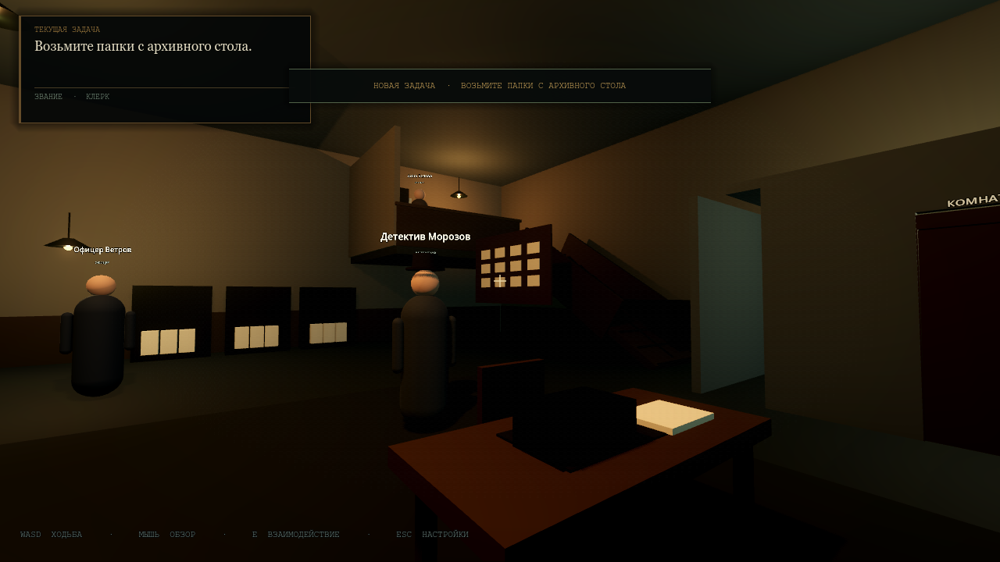

## Quick start

1. Install **Godot 4.3** (the standard build with the **Forward+** renderer).
2. Start Godot, click **Import**, and choose this folder's `project.godot`.
3. Wait for the first import to finish.
4. Press **F5**. The main scene is `res://scenes/HawkinsStation.tscn` — the station grounds at night.
5. Walk to the lit **POLICE** entrance and press **E** to enter the station; the existing interior story loads.
6. Wait for Chief Arkady to walk up, then read the intro dialogue.
7. Use **E** to interact, **WASD** to move, mouse to look, and **Esc** for Settings.
8. The game starts in Russian. Switch to English from Settings if needed.

No manual scene setup is required — all scenes and resources are included and wired together.

> Compatibility note: the project is authored for Godot 4.3. The earlier Station and movement QA routes passed in **Godot 4.3.stable**; the expanded story and environment pass were re-run in 4.7.2. Older chapter prototypes remain available from their scenes.

## Station grounds (main map)

**F5 now starts outside the Hawkins police station.** The imported building sits in the middle of a decorated night-time lot: parking bays, two police cruisers and civilian cars, a perimeter fence with gate pillars, sodium street lamps, trees and hedges, entrance planters, benches, bins, a hydrant, a newspaper box, a flagpole, a lit doorway and a department monument sign.

The Sketchfab model is an exterior shell with no interior rooms or colliders, so it is used as the station's outside. The bright front door is an E interactable that fades into the untouched interior story (`scenes/Station.tscn`); the original prototype can still be opened directly with **F6**.

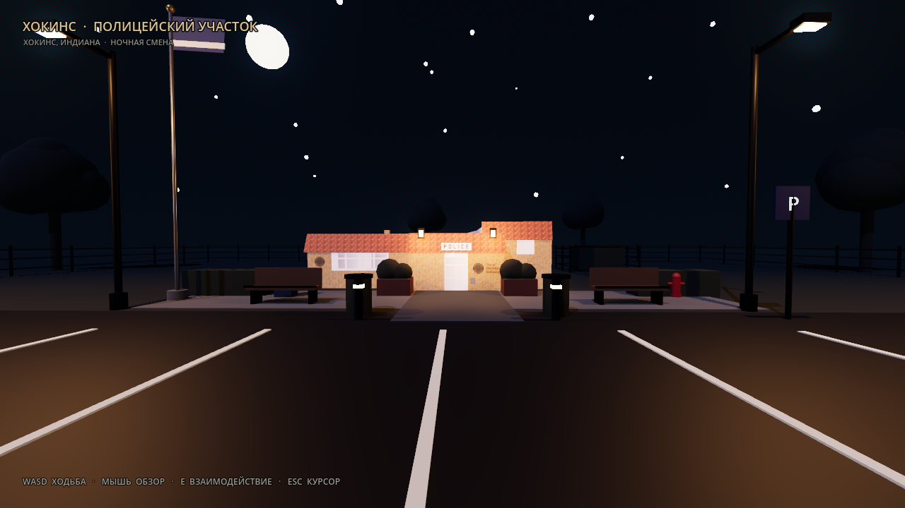

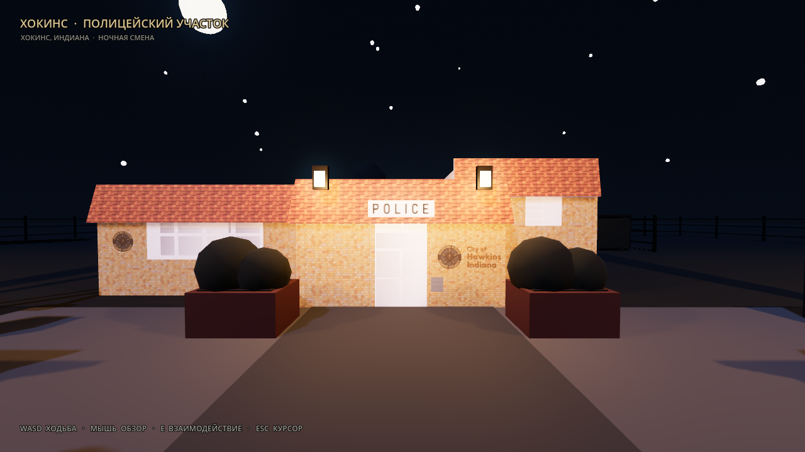

- Scene: `scenes/HawkinsStation.tscn`
- Controller and HUD: `scripts/hawkins_station.gd`
- Door interaction proxy: `scripts/hawkins_entrance.gd`
- Runtime star field: `scripts/hawkins_stars.gd`
- Rebuild the decorated grounds: `godot --headless --path . --script res://tools/build_hawkins_map.gd`
- Model credit: **“Hawkins Police Station”** by **Sea Land Air** (Sketchfab), **CC-BY-4.0** — see `assets/models/hawkins_police_station/ATTRIBUTION.md`.

## Police Station prototype (main)

The station is one continuous scene with an archive, main hall with clerk desks, break room, staircase/ramp and a second-floor Chief's office. Seven NPCs use NavigationAgent3D patrol routes; two doorways open automatically with AnimationPlayer clips; the objective HUD tracks a data-driven quest; and the dialogue system fires story events such as `start_quest` and `give_promotion`.

Story flow in the shipped build:

1. **Archive.** Chief Arkady walks to the player and says: *“Take these folders to my office upstairs. The Kravtsov file stays in the archive. Don't be late.”*
2. **Folder pickup.** The glowing case folder on the archive desk is an E interactable.
3. **Detective warning.** On the way out, Detective Vlasov stops the player and reveals that the folder is a prop. The real Kravtsov report is in his locker in the break room.
4. **The choice.** The player can search the break room locker for the report or ignore it and go straight upstairs.
5. **Chief's office.** On the raised office floor, two interactions are available:
   - **Hand over the folders** at the Chief's desk → promotion to Duty Officer, but the Kravtsov report stays in your pocket.
   - **Put the Kravtsov report on the desk** (only after finding it) → confrontation with the Chief. He offers the rank in exchange for silence; this path ends without a promotion but with the truth kept.
6. **Two endings.** The HUD objective and final toast reflect whether the player became part of the cover-up or kept the evidence.

The station also gained detailed environment models: the swinging doors now have framed frosted glass, raised panels, hinges, a metal kick plate and lever handles; the staircase has individual treads, risers, wood nosings, stringers, open handrails with balusters, newel posts and stair lighting.

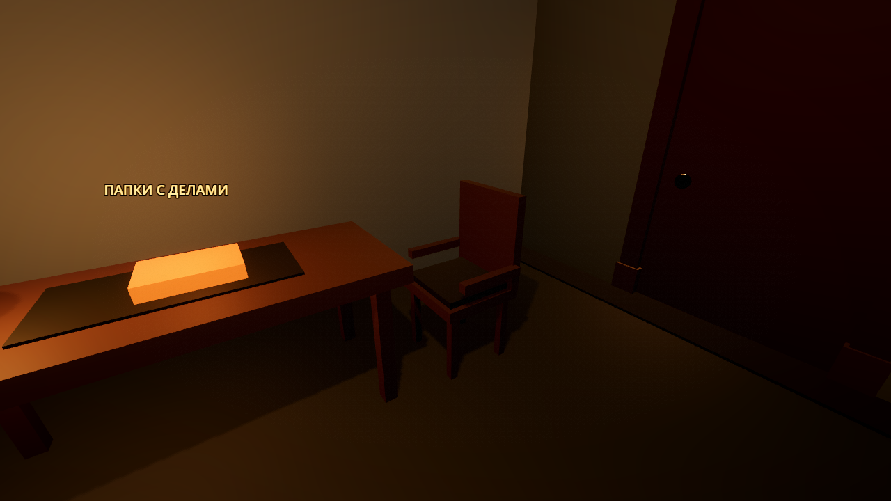

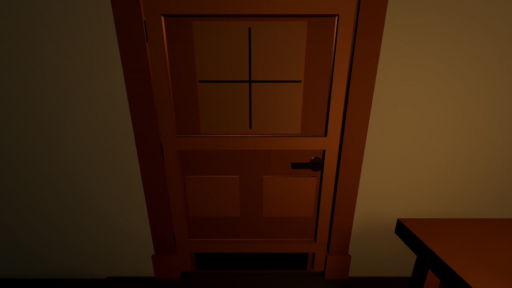

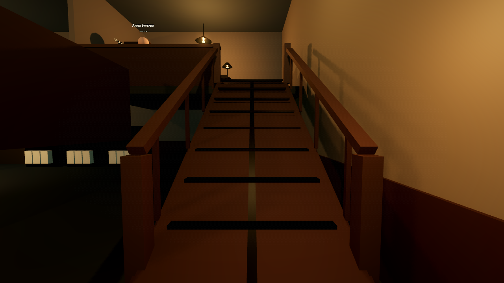

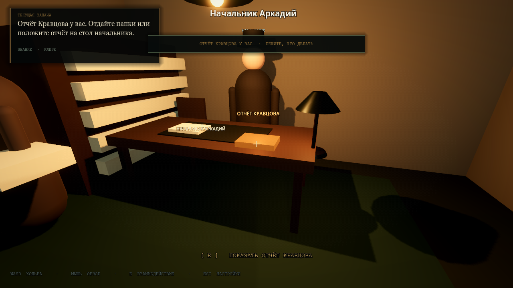

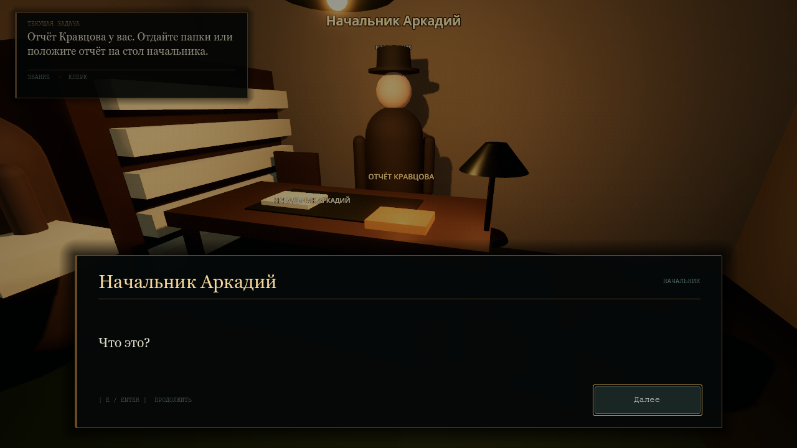

### Full Station guide

The complete node trees, NPC/Player setup, NavigationRegion3D baking steps, door wiring, interaction IDs and dialogue-event examples are in **[docs/STATION_SETUP.md](docs/STATION_SETUP.md)**.

### Station source files

```text
scenes/
  Station.tscn            Main scene: station, baked navmesh, NPCs, HUD
  NPC.tscn                Capsule NPC + NavigationAgent3D + name/role labels
  Player.tscn             Existing first-person controller, reused
  StationDialogueUI.tscn  Bottom-screen dialogue layer
  StationHUD.tscn         Objective/rank/prompt HUD
  StationDoor.tscn        Area3D + AnimationPlayer swinging door

scripts/
  station.gd              Story controller, interaction router, promotion
  station_npc.gd          Idle / Walking / Talking states and patrols
  dialogue_manager.gd     DialogueManager autoload
  quest_manager.gd        QuestManager autoload
  station_dialogue_ui.gd  Renders DialogueManager lines
  station_hud.gd          Objective and rank UI
  station_door.gd         Runtime AnimationPlayer clips
  station_interactable.gd Generic folder/desk interaction
```

## Legacy prototypes

The earlier Chapter 1 archive and Chapter 2 duty room remain in the project and are still playable from their own scenes (`Archive.tscn` and `DutyRoom.tscn` via F6). Their notes follow below.

## Chapter 2 — The Duty Room (optional scene)

A small police duty room at night: a desk, an old rotary telephone, an open duty journal, a city map, a rain-streaked window, one warm desk lamp and cold light from the street. The shift is three phone calls long. Open `scenes/DutyRoom.tscn` and press **F6** to play it.

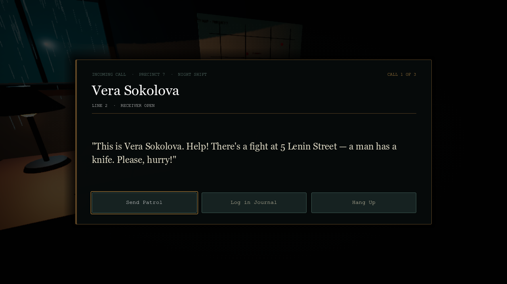

### The three calls

1. **Violent crime** — Vera Sokolova reports a fight and a knife at 5 Lenin Street. The correct action is **Send Patrol**.
2. **Noise complaint** — Nikolai Petrov reports loud music at 12 Gorky Street. The correct action is **Log in Journal**, with his name and address entered correctly.
3. **The Kravtsov call** — a distorted voice orders you not to send a patrol to 5 Lenin Street. You can **Agree** (+1 corruption) or **Refuse and Send Patrol** (+1 honesty, the Chief wants to see you).

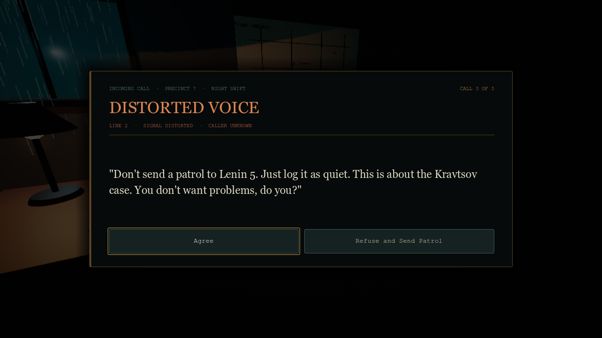

### Mechanics

- **Incoming call.** The phone rings as the scene opens. Walk to the desk, aim at the telephone, and press **E**; the HUD's incoming banner changes into the modal incoming-call view.
- **Three actions.** `Send Patrol`, `Log in Journal`, and `Hang Up`. Wrong actions are reprimands (for example, sending a patrol to a noise complaint or filing a violent crime instead of dispatching).
- **Journal.** Choosing **Log in Journal** opens a separate open-journal UI with caller-name and address fields. Wrong or blank fields are a reprimand. Case, punctuation and repeated whitespace are ignored; some street abbreviations are accepted via per-call aliases.
- **Three reprimands = game over.** `CareerManager` owns the counter and the game-over state.
- **Reputation.** Honesty and corruption points are tracked; the final screen derives an `honest`, `corrupt` or `neutral` reputation.
- **Final report.** After three calls (or three reprimands) a final screen reports reprimands, honesty, corruption, calls handled and the Chief notification.

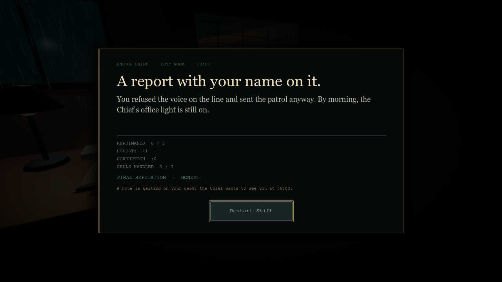

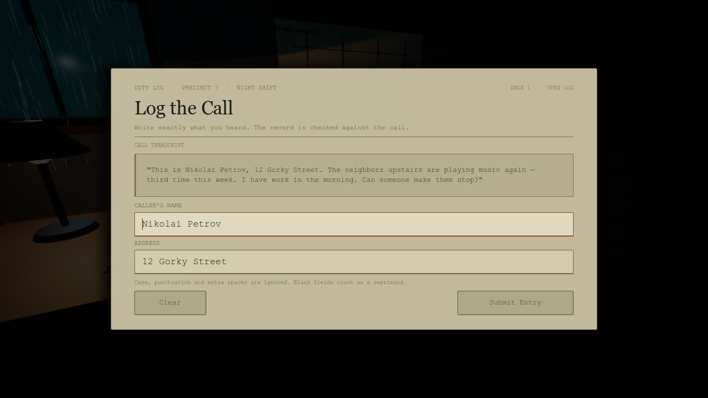

### Full Chapter 2 guide

The complete scene tree, step-by-step construction instructions, phone/RayCast wiring, call-data format and customisation notes are in **[docs/CHAPTER2_DUTY_ROOM.md](docs/CHAPTER2_DUTY_ROOM.md)**.

### Chapter 2 source files

```text
scripts/
  career_manager.gd       CareerManager autoload
  call_manager.gd         DutyRoom scene script: calls, validation, scoring, HUD
  phone.gd                Phone highlight, ring audio/animation
  phone_ui.gd             Incoming-call / choices / twist / feedback UI
  logbook_ui.gd           Caller-name and address form
  duty_results_ui.gd      Final shift report

scenes/
  DutyRoom.tscn           Full 3D room + HUD + UI instances
  PhoneUI.tscn            CanvasLayer 20
  LogbookUI.tscn          CanvasLayer 26
  DutyResultsUI.tscn      CanvasLayer 40
```

## Chapter 1 — Archive. First Day.

A playable first-person noir prototype: one basement archive, three files, one signature that should not exist. The archive chapter is unchanged and still launches from `res://scenes/Archive.tscn`.

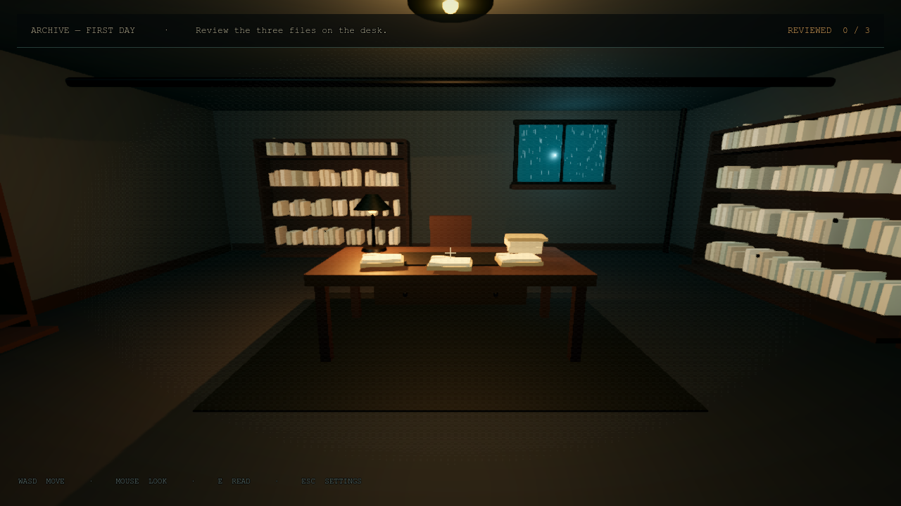

## Controls

| Input | Action |
| --- | --- |
| **W A S D** | Move at 3 m/s |
| **Mouse** | Look |
| **E** | Interact with a highlighted folder, NPC or desk / answer the phone in Chapter 2 |
| **Esc** | Open Settings and release the mouse cursor |
| **Esc** (in Settings) | Close Settings and return to the game |
| **Left click** | Capture the cursor if it is visible |
| **Mouse (UI)** | Use buttons, sliders, and the language selector |

The interaction ray is a 2.5 m `RayCast3D` parented to the camera. Aim at an interactable until its highlight and prompt appear, then press **E**. The ray is checked at a throttled 60 ms cadence rather than every physics frame.

## Settings

Esc opens the noir-styled Settings overlay while playing. Settings are written immediately to `user://archive_settings.cfg` and restored on the next launch. The Chapter 2 instance overrides only the kicker and Esc hint so the overlay reads “DUTY ROOM”; the station uses its own “PRECINCT 7” context.

### Sound

- **Sound** toggle mutes/unmutes the whole game through the Master audio bus.
- **Master volume** slider (0–100%) applies live while dragging; the config write is debounced to avoid disk churn.
- All game audio is synthesised at runtime in `AudioManager`:
  - a looping filtered-rain room tone;
  - footsteps;
  - paper rustle for opening and flipping files;
  - UI clicks;
  - a low dialogue sting;
  - a stamp thud for the shift summary;
  - a looping mechanical telephone bell and a handset clack for Chapter 2.

No audio files are imported. Six reusable `AudioStreamPlayer` nodes prevent per-sound node allocations, alongside the phone's positional `AudioStreamPlayer3D`.

### Language

- **Russian is the default language** on first launch. Existing version-1 settings are migrated to Russian automatically.
- **English** and **Русский** remain available from the language dropdown.
- Switching language is live and immediate for the HUD, objectives, dialogue, documents, folder titles, calls, reports and Settings.
- The Station's dialogue, objectives, interaction prompts, toasts, NPC names, roles and room signs are all localized; Russian text ships in every Station dialogue resource.
- The choice persists between launches.
- Chapter 2 call data stores optional `_ru` fields and uses `Loc.pick()`, so new calls can be bilingual without new translation keys for every line.

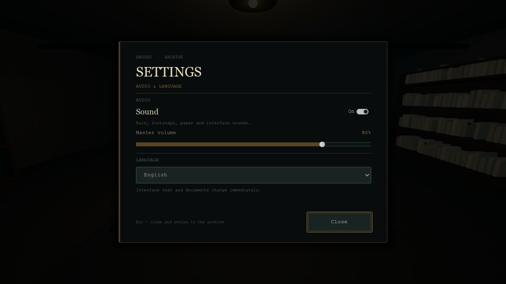

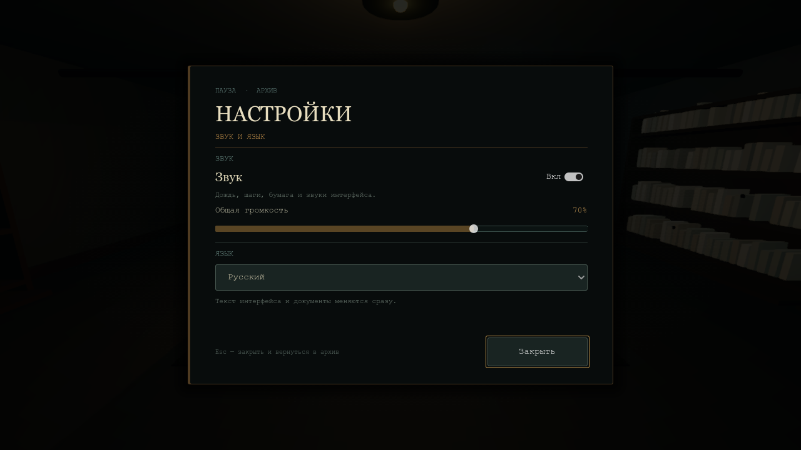

## Chapter 1 — The shift

- Three interactive folders sit on the central desk. Walk close and look down at them.
- Opening a folder shows a document reader with a front and reverse page. **Flip** switches pages.
- **Find Error** can be used once per file. Two files are faulty; one is clean.
- The normal shift ends when all three documents have been opened and closed. The report shows correct finds, missed errors, and any mistaken flags.
- The third file, **Case No. 1987-K**, hides a special signature error. Pressing **Find Error** on it skips the usual feedback and starts Arkady Petrovich's dialogue. After **Understood**, the shift report appears immediately. This early ending is intentional and can be toggled off.

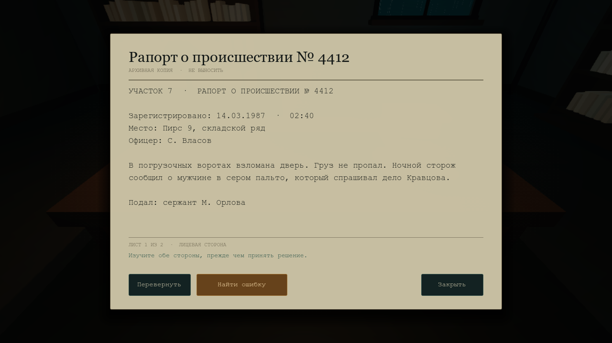

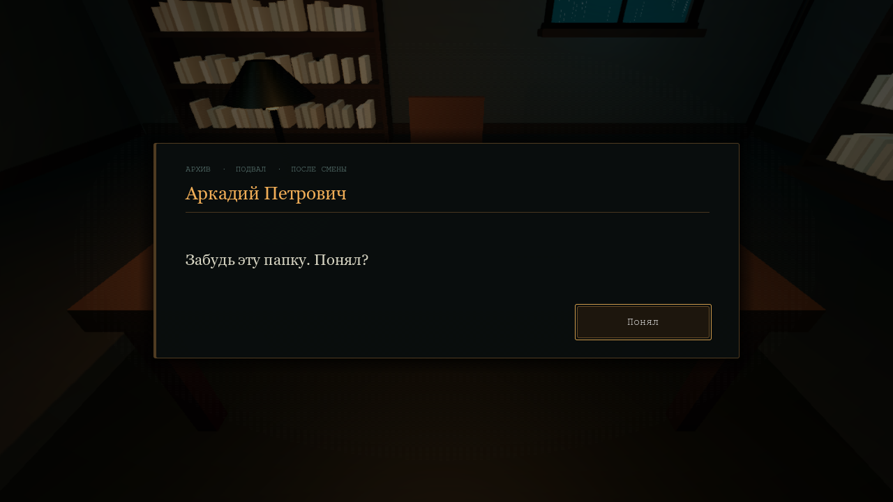

### Exported story switch

`Archive.gd` exposes:

```gdscript
@export var end_shift_after_forbidden_case: bool = true
```

- `true` (default): Arkady's conversation ends the shift immediately, matching the story trigger.
- `false`: dismiss the dialogue and continue reviewing the remaining files. The report appears after all three files close.

## Project structure

```text
project.godot                  Main scene, Forward+ setup, Input Map, autoloads
README.md

autoloads (in project.godot)
  Loc                          Language dictionaries and live switching
  AudioManager                 Procedural WAV synthesis + reusable SFX pool
  Settings                     Persisted sound/volume/language preferences
  CareerManager                Duty Room reprimands/honesty/corruption/reputation
  DialogueManager              Data-driven dialogue chains and story events
  QuestManager                 Objectives, story flags and player rank

scenes/
  Station.tscn                 Main scene: station, NPCs, baked navmesh, HUD
  NPC.tscn                     CharacterBody3D NPC + NavigationAgent3D
  StationDialogueUI.tscn       Station dialogue layer
  StationHUD.tscn              Objective/rank/prompt HUD
  StationDoor.tscn             Area3D-triggered AnimationPlayer door
  DutyRoom.tscn                Duty Room: room, phone, HUD, UI instances
  PhoneUI.tscn                 Duty Room: incoming-call and action UI
  LogbookUI.tscn               Duty Room: caller-name/address journal
  DutyResultsUI.tscn           Duty Room: final shift report
  Archive.tscn                 Archive: room, lights, HUD, UI instances
  Player.tscn                  CharacterBody3D + Camera3D + RayCast3D
  Folder.tscn                  StaticBody3D folder with export data
  Shelf.tscn                   Reusable shelf with one MultiMesh for all files
  FolderUI.tscn                CanvasLayer document reader
  DialogueUI.tscn              Chapter 1 Resource-driven dialogue
  FinalUI.tscn                 Archive end-of-shift report
  SettingsUI.tscn              CanvasLayer audio/language settings
  NoirOverlay.tscn             CanvasLayer grain/vignette/scanline pass

scripts/
  station.gd                   Station story controller and interaction router
  station_npc.gd               NPC Idle/Walking/Talking navigation states
  station_dialogue_ui.gd       Station dialogue presentation
  station_hud.gd               Objective/rank/prompt UI
  station_door.gd              Runtime-built door animations
  station_interactable.gd      Generic folder/desk interaction + highlight
  dialogue_manager.gd          DialogueManager autoload
  quest_manager.gd             QuestManager autoload
  career_manager.gd            Duty Room career autoload
  call_manager.gd              Duty Room call queue and state machine
  phone.gd                     Duty Room phone highlight, ring and audio
  phone_ui.gd                  Duty Room incoming/choices/twist/feedback UI
  logbook_ui.gd                Duty Room journal form
  duty_results_ui.gd           Duty Room final report
  archive.gd                   Archive manager: scoring, progression, endings
  player.gd                    Shared movement, look, throttled ray focus
  folder.gd                    Archive folder data + highlight + localization
  folder_ui.gd                 Archive document UI behaviour
  dialogue_line.gd             DialogueLine Resource + story event fields
  dialogue_ui.gd               Chapter 1 dialogue chain player
  final_ui.gd                  Archive shift report UI
  settings_ui.gd               Shared audio and language controls
  settings_manager.gd          ConfigFile persistence and application of settings
  localization.gd              Loc dictionaries and live language switching
  audio_manager.gd             Procedural audio synthesis and playback
  shelf.gd                     MultiMesh shelf-file generator
  flicker_lamp.gd              Random Timer-driven OmniLight flicker

docs/
  STATION_SETUP.md             Full Station scene tree and navigation guide
  CHAPTER2_DUTY_ROOM.md        Full Duty Room scene tree and build guide
  screenshots/                 Preview images only; not used by the game

materials/                     Shared StandardMaterial3D resources
shaders/
  noir_overlay.gdshader        Screen-texture-free grain, scanlines, vignette

resources/
  forget_the_folder.tres       Arkady's Chapter 1 dialogue line
  dialogues/                   Station dialogue chains and generic NPC chats
```

## Localization

`Loc` is a lightweight autoload in `scripts/localization.gd`:

```gdscript
signal locale_changed(new_locale: String)

func set_locale(locale_code: String) -> void
func t(key: String, args: Array = []) -> String
func pick(data: Dictionary, base_key: String) -> String
func get_supported_locales() -> Array[String]
func get_language_name(locale_code: String) -> String
```

All interface strings are stored under `TRANSLATIONS["en"]` and `TRANSLATIONS["ru"]`. Scripts subscribe to `Loc.locale_changed` and refresh in place.

Chapter 2 calls store content directly in their dictionaries, with optional Russian variants. `Loc.pick(call, "text")` returns `text_ru` in Russian when it is non-empty, otherwise `text`:

```gdscript
{
    "caller": "Mikhail Orlov",
    "caller_ru": "Михаил Орлов",
    "address": "9 Sadovaya Street",
    "address_ru": "улица Садовая, 9",
    "text": "\"Someone is breaking into the pharmacy at 9 Sadovaya Street.\"",
    "text_ru": "\"Кто-то взламывает аптеку на Садовой, 9.\"",
    "correct_action": "dispatch",
}
```

See the full Chapter 2 guide for the complete call dictionary format and the special-call extension point.

Folder content uses per-instance exported fields:

```gdscript
@export var folder_title: String
@export_multiline var document_text: String
@export_multiline var document_back_text: String

@export var folder_title_ru: String
@export_multiline var document_text_ru: String
@export_multiline var document_back_text_ru: String
```

Empty Russian fields fall back to the English values. The floating 3D labels and the HUD prompt use the same localized getters.

`DialogueLine` now carries:

```gdscript
@export var speaker: String
@export_multiline var text: String
@export var speaker_ru: String
@export_multiline var text_ru: String
@export var next_line: DialogueLine
```

The dialogue UI picks the Russian fields when the locale is `ru`. The final button is translated too (`Understood` / `Понял`).

### Adding a language

1. Add the code to `SUPPORTED_LOCALES` and a native name to `LANGUAGE_NAMES` in `localization.gd`.
2. Add a dictionary with the same keys under `TRANSLATIONS`.
3. Add the corresponding folder/dialogue Russian-style fields for content, or use your preferred content strategy.
4. The Settings dropdown is built from `Loc.get_supported_locales()` automatically.

## Scene structure

### `Archive.tscn`

```text
Archive (Node3D, archive.gd)
├─ WorldEnvironment (teal fog, volumetric fog, glow, SSAO, ACES tonemap)
├─ ColdDirectional / ColdRoomFill
├─ Room, Rug, Pipes
├─ Shelves
│  └─ ShelfNorth / ShelfSouth / ShelfWest / ShelfEast (Shelf.tscn instances)
├─ Window (emissive night plane, rain particles, glass, frames, cool light)
├─ CeilingLamp (wire, shade, emissive bulb, flickering OmniLight3D)
├─ Desk (table, lamp, paper stacks, chair)
├─ Folders
│  ├─ FolderIncident       (has_error = true,  error_type = "date")
│  ├─ FolderInventory      (has_error = false)
│  └─ FolderCase1987K      (has_error = true,  error_type = "signature")
├─ Player (Player.tscn)
├─ HUD (CanvasLayer 10)
├─ NoirOverlay (CanvasLayer 5)
├─ FolderUI (CanvasLayer 20)
├─ DialogueUI (CanvasLayer 30)
├─ FinalUI (CanvasLayer 40)
└─ SettingsUI (CanvasLayer 50)
```

### `SettingsUI.tscn`

```text
SettingsUI (CanvasLayer 50, settings_ui.gd)
└─ Root
   ├─ Dim
   └─ Center → Panel → Margin → VBox
      ├─ Kicker, Title, Subtitle
      ├─ Rule
      ├─ AudioLabel
      ├─ SoundRow (SoundLabel + SoundToggle)
      ├─ SoundHint
      ├─ VolumeHeader (VolumeLabel + VolumeValue)
      ├─ VolumeSlider
      ├─ Rule2
      ├─ LanguageLabel
      ├─ LanguageOption
      ├─ LanguageHint
      ├─ Spacer
      └─ Footer (EscHint + CloseButton)
```

### Other scenes

```text
Player (CharacterBody3D, player.gd)
├─ CollisionShape3D (Capsule)
└─ Head → Camera3D → InteractionRay (2.5 m, mask 5)

Folder (StaticBody3D, folder.gd)
├─ Cover / Pages / Tab (MeshInstance3D)
├─ CollisionShape3D
└─ TitleLabel (Label3D)

FolderUI / DialogueUI / FinalUI are CanvasLayer UI roots with
the node paths used by their respective scripts.
```

## Dialogue Resource system

The story line is stored in `resources/forget_the_folder.tres`:

```text
speaker     = "Arkady Petrovich"
text        = "Forget this folder. Understood?"
speaker_ru  = "Аркадий Петрович"
text_ru     = "Забудь эту папку. Понял?"
next_line   = null
```

Linking the Resource to the UI happens in two steps:

1. `Archive.tscn` assigns the resource to `archive.gd`'s exported property:

```gdscript
@export var forgotten_case_dialogue: DialogueLine
```

2. When the signature error is found, `Archive.gd` passes the Resource to the CanvasLayer:

```gdscript
dialogue_ui.show_dialogue(forgotten_case_dialogue)
```

`DialogueUI.show_dialogue()` walks the chain with `current_line.next_line`. The last line changes the button to the localized equivalent of **Understood**; intermediate lines would use **Next**. To add another line, create a `DialogueLine` `.tres`, assign it to **Next Line** in the Inspector, and repeat for longer chains.

## Input Map

| Action | Key |
| --- | --- |
| `move_forward` | W |
| `move_back` | S |
| `move_left` | A |
| `move_right` | D |
| `interact` | E |
| `ui_cancel` | Esc |

`ui_cancel` is consumed by the active scene controller (Station, Archive or Duty Room): it opens Settings while playing and closes Settings when the overlay is open, except during a phone modal. The cursor is released while the overlay or a call UI is visible.

## Lighting, fog, and audio-visual look

- Renderer: **Forward+** (needed for volumetric fog).
- `WorldEnvironment` uses fog with `fog_density = 0.05`, volumetric fog, ACES tonemapping, cool ambient color, glow, and SSAO.
- Cold, dim directional fill; warm desk OmniLight; cool window light; cool room fill.
- The ceiling OmniLight flickers with a randomized one-shot `Timer`.
- The desk lamp is the single shadow-casting point light; the flickering ceiling light no longer renders a shadow cubemap.
- Rain is a `GPUParticles3D` volume of thin BoxMesh streaks, backed by an emissive night plane and faint glass.
- `NoirOverlay.tscn` blends animated grain, scanlines, and a vignette over the 3D view without sampling `SCREEN_TEXTURE`. This replaced the former full-screen screen-copy grade for a significant fill-rate saving while preserving the film look.
- All world materials are shared `StandardMaterial3D` resources, generally roughness 0.8–0.9 and metallic 0.05–0.15.

## Performance notes

The final pass focused on the integrated-GPU case:

- **Shelf files:** 306 file boxes are packed into **4 MultiMesh draw calls** (one per shelf) instead of hundreds of individual `MeshInstance3D` nodes; file meshes do not cast shadows.
- **Draw calls:** measured at **57** in the test scene after the optimisation.
- **Anti-aliasing:** 4× MSAA with FXAA disabled for sharper primitive edges.
- **Render scale:** 3D renders at 1.0; UI remains full resolution.
- **Shadows:** positional shadow atlas raised to 2048 for cleaner contact shadows.
- **Rain particles:** 100 particles, 30 Hz fixed simulation, interpolate off.
- **Interaction ray:** re-cast at 60 ms intervals rather than every physics tick.
- **Overlay:** no screen texture sampling; grain, scanlines and vignette were reduced for a clearer image.
- **Audio:** all WAVs generated once at startup and reused from a six-player pool.
- **Settings I/O:** volume changes are debounced before writing to `user://archive_settings.cfg`.

If you need more headroom on older integrated GPUs, lower `rendering/scaling_3d/scale`, disable MSAA, or lower the shadow atlas. The current default favours clarity over the earlier 0.8-scale FXAA preset.

## Manual setup checklist

All of this is already present; this list is for rebuilding or repairing the project.

1. Create a Forward+ project and set `res://scenes/Station.tscn` as the main scene.
2. Register the six autoloads in this order: `Loc`, `AudioManager`, `Settings`, `CareerManager`, `DialogueManager`, `QuestManager`.
3. Add the six input actions listed above.
4. Create `Player.tscn` with a capsule, a `Head` at y ≈ 1.62, a camera, and the 2.5 m interaction ray.
5. Build the Station layout, NPCs, waypoint markers and baked `NavigationRegion3D` following the Station guide.
6. Create the Station UI layers: SettingsUI 50, StationDialogueUI 30, StationHUD 10, NoirOverlay 5. Set the Player instance's collision mask to 13 and use Doors layer 4.
7. For Chapter 2, create the three UI CanvasLayers and follow the Chapter 2 guide; open `DutyRoom.tscn` with F6.
8. For Chapter 1, create `Folder.tscn` with exported fields and rebuild the archive room.
9. Verify UI and node paths against the scripts in each scene.

## Script/node path dependencies

- `station.gd`: `$Player`, `$NPCs/Chief`, `$NPCs/DetectiveVlasov`, `$NavigationRegion3D/Props/Folder`, `$NavigationRegion3D/Props/ChiefDesk`, `$StationHUD`, `$StationDialogueUI`, `$SettingsUI`, `$Triggers/DetectiveTrigger`, `$Waypoints/ChiefOffice`
- `station_npc.gd`: `$Visual`, `$Visual/Body`, `$Visual/Head`, `$Visual/LeftArm`, `$Visual/RightArm`, `$Visual/Hat`, `$NameLabel`, `$RoleLabel`, `$NavigationAgent3D`, `$FocusRing`
- `station_dialogue_ui.gd`: `$Root/Panel/Margin/VBox/*`
- `station_hud.gd`: `$Root/ObjectivePanel/Margin/VBox/*`, `$Root/Prompt`, `$Root/Toast/*`
- `station_door.gd`: `$Pivot`, `$Trigger`, `$AnimationPlayer`, `$DoorLabel`
- `call_manager.gd`: `$Player`, `$Desk/Phone`, `$PhoneUI`, `$LogbookUI`, `$ResultsUI`, `$SettingsUI`, `$HUD/Root/*`
- `phone.gd`: `$Base`, `$Handset`, `$Cord`, `$RingPlayer`
- `phone_ui.gd`: `$Root/Center/Panel/Margin/VBox/*`
- `logbook_ui.gd`: `$Root/Center/Paper/Margin/VBox/*`
- `duty_results_ui.gd`: `$Root/Center/Panel/Margin/VBox/*`
- `archive.gd`: `$Player`, `$FolderUI`, `$DialogueUI`, `$FinalUI`, `$SettingsUI`, `$HUD/Root/*`
- `player.gd`: `$Head`, `$Head/Camera3D`, `$Head/Camera3D/InteractionRay`
- `folder.gd`: `$Cover`, `$Pages`, `$Tab`, `$TitleLabel`
- `folder_ui.gd`: exact paths below `$Root/Center/Paper/Margin/VBox`
- `dialogue_ui.gd`: `$Root/Center/Panel/Margin/VBox/*`
- `final_ui.gd`: `$Root/Center/Panel/Margin/VBox/*`
- `settings_ui.gd`: `$Root/Center/Panel/Margin/VBox/*`

## Customisation

- **Add a Station NPC:** instance `NPC.tscn`, set its exports and assign a `DialogueLine`; add waypoint markers to a group and set `waypoint_group`.
- **Add a Station dialogue:** duplicate a `.tres` in `resources/dialogues/`, fill the text and link `next_line`.
- **Trigger a quest or promotion:** add `event_name`/`event_payload` to a final line and handle it in `Station.gd`. See `docs/STATION_SETUP.md`.
- **Change the scene from dialogue:** set `event_name = "change_scene"` and `event_payload` to a scene path.
- **Add a Chapter 2 call:** append a Dictionary to `calls` in `call_manager.gd`.
- **Tune the Chapter 2 shift:** adjust `between_call_delay` on the DutyRoom node, the call dictionaries, or `CareerManager.MAX_REPRIMANDS`.
- **Add an archive file:** duplicate a folder instance in `Archive.tscn` and fill in the exported fields.
- **Add a language:** extend `localization.gd` as described above.
- **Retune the mood:** edit shared materials and each scene's `WorldEnvironment`.
- **UI fonts:** the UI uses `SystemFont` fallbacks (Georgia/Courier New/etc.). Add `.ttf` files only if you want to replace those; none are shipped.

## Verification performed here

A temporary QA tour passed:

**Station prototype (expanded story QA):**
- the archive intro starts automatically and Chief Arkady reaches the player;
- the intro event starts the folder-delivery quest and updates the Russian objective HUD;
- the real interaction ray focuses the folder and the E event consumes it;
- the detective warning triggers the Kravtsov hook and the locker tip;
- the break-room locker gives the report and reveals the office evidence prop;
- the **standard branch** hands over the folders, grants the promotion and leaves the report untouched;
- the **truth branch** confronts the Chief with the report, sets `truth_kept`, refuses the promotion and seals the desk against a later promotion;
- both branch objectives and final toasts are Russian;
- the archive chair is beside the desk, the door has its glass/lever/hinge pieces and the staircase has risers, nosings, stringers and handrails;
- earlier movement QA confirmed the automatic door, ramp traversal and real ray/E pickup.

**Chapter 2 — The Duty Room (54 assertions, verified in Godot 4.3.stable and 4.7.2):**
- all three calls, both twist branches, journal validation, reprimands, game over and final report pass.

**Chapter 1 — Archive:** the existing QA tour remains valid: input actions, mouse capture, Settings, localization persistence, audio, folder review, forbidden-signature dialogue, final report and restart.

Audio generation and playback initialise without errors. The temporary Station builder and QA harnesses were removed from the shipped project.

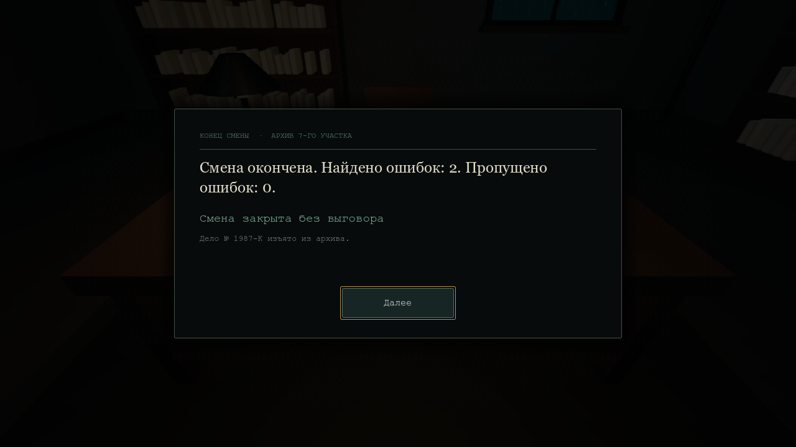
