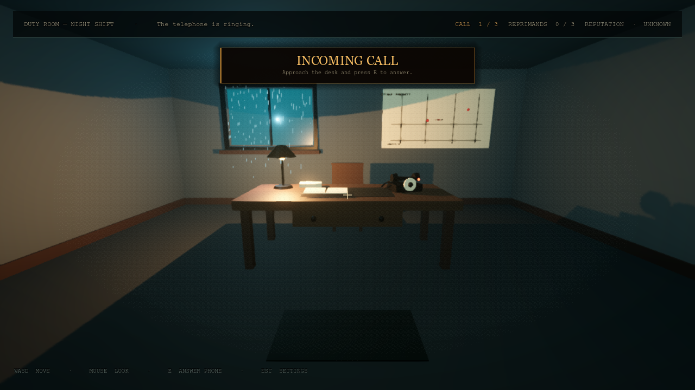
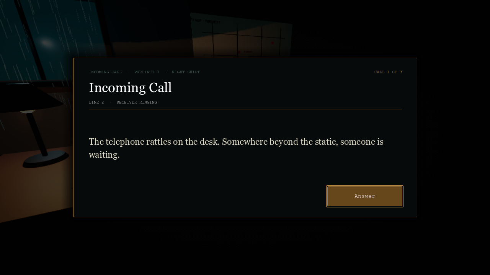
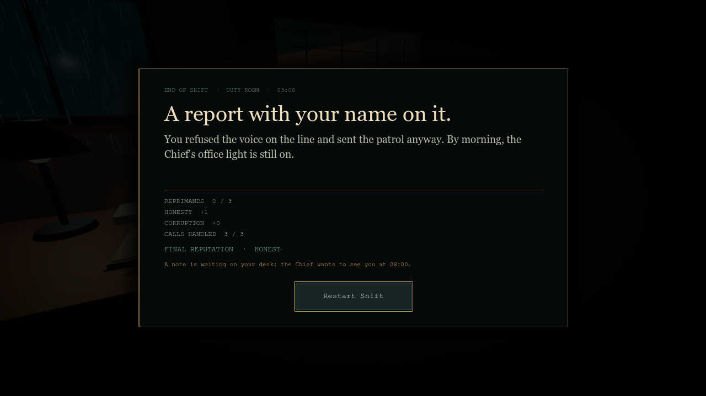

# Chapter 2 — The Duty Room

A complete, self-contained Godot 4.3 prototype for the night-shift phone-call chapter. It is a standalone legacy/optional scene; the project's current main scene is `res://scenes/Station.tscn`. To play this chapter, open `res://scenes/DutyRoom.tscn` in the editor and press **F6**.



## What is included

- A first-person noir duty room built from Godot primitives: desk, chair, rotary telephone, open duty journal, city map with pins, rain-streaked window, warm desk lamp, cold window light, fog, grain and a volume of rain particles.
- Three calls with a full state machine: ringing → incoming → caller text → action → feedback → next call → shift report.
- A separate `PhoneUI` (CanvasLayer 20) and `LogbookUI` (CanvasLayer 26).
- A journal with text fields for the caller's name and address. Case, punctuation and repeated spaces are ignored; abbreviations such as `St.` are accepted when listed in the call's aliases.
- A `CareerManager` autoload that owns reprimands (3 = game over), honesty, corruption and the derived reputation.
- The Kravtsov twist with Agree / Refuse branches, corruption/honesty points and the Chief notification.
- An end-of-shift report (CanvasLayer 40) with restart.
- English and Russian localization through the existing `Loc` autoload.
- Procedural desk-phone ring audio and a handset clack, generated by the existing `AudioManager`.

## Quick start

1. Open the project in **Godot 4.3** with the Forward+ renderer.
2. Open `res://scenes/DutyRoom.tscn` and press **F6**. The current main scene is `Station.tscn`; this chapter is separate.
3. Walk to the desk, aim at the glowing telephone and press **E**.
4. In the incoming-call window, click **Answer**.
5. Make one of the three choices; for a journal entry, type the caller's name and address exactly as heard and submit.
6. Complete all three calls. The final report shows reprimands, honesty, corruption and reputation.
7. Open Settings with **Esc** between calls. The cursor is released for the UI and recaptured when you return.

The full script and scene list is in [Project files](#project-files).

## Walking through the prototype

### Call 1 — violent crime

Caller: **Vera Sokolova**, **5 Lenin Street**.

> "This is Vera Sokolova. Help! There's a fight at 5 Lenin Street — a man has a knife. Please, hurry!"

Correct action: **Send Patrol**. Logging it or hanging up is a reprimand. If you choose Log in Journal and also type the wrong details, that is two separate reprimands.

### Call 2 — noise complaint

Caller: **Nikolai Petrov**, **12 Gorky Street**.

> "This is Nikolai Petrov, 12 Gorky Street. The neighbors upstairs are playing music again — third time this week. I have work in the morning. Can someone make them stop?"

Correct action: **Log in Journal**, with the name and address entered correctly. Sending a patrol is a reprimand.

### Call 3 — the Kravtsov call

An unknown, distorted voice:

> "Don't send a patrol to Lenin 5. Just log it as quiet. This is about the Kravtsov case. You don't want problems, do you?"

- **Agree**: the line goes dead, **+1 corruption**. No reprimand is issued, but the final reputation becomes compromised.
- **Refuse and Send Patrol**: **+1 honesty**, and the Chief wants to see you at 08:00.

Three reprimands at any point end the shift immediately; the next screen is the game-over report.





## Project files

| File | Purpose |
| --- | --- |
| `project.godot` | Main scene is `Station.tscn`; `CareerManager` autoload remains registered for this optional chapter. |
| `scripts/career_manager.gd` | Autoload: reprimands, honesty, corruption, reputation, game over. |
| `scripts/call_manager.gd` | Call queue, state machine, validation, scoring and HUD wiring. Attached to the `DutyRoom` root. |
| `scripts/phone_ui.gd` | Incoming-call, caller, choices, twist and feedback views. |
| `scripts/logbook_ui.gd` | Caller-name and address fields plus submit/clear. |
| `scripts/duty_results_ui.gd` | Final shift report. |
| `scripts/phone.gd` | Highlight, ring animation and positional ring audio for the telephone. |
| `scenes/DutyRoom.tscn` | Full 3D scene, HUD and UI instances. |
| `scenes/PhoneUI.tscn` | CanvasLayer 20 telephone interface. |
| `scenes/LogbookUI.tscn` | CanvasLayer 26 open duty journal. |
| `scenes/DutyResultsUI.tscn` | CanvasLayer 40 end-of-shift report. |
| `scenes/Player.tscn` | Existing Chapter 1 first-person controller, reused unchanged except for the extra interactable group. |

## Scene tree

This is the actual structure of `scenes/DutyRoom.tscn`. Script names and the paths used by the scripts are shown in parentheses.

```text
DutyRoom (Node3D, call_manager.gd)
├─ WorldEnvironment              # fog, volumetric fog, glow, SSAO, ACES
├─ ColdDirectional               # weak cool fill from outside
├─ ColdRoomFill                  # cool room bounce
├─ Room
│  ├─ Floor (StaticBody3D)
│  ├─ Ceiling
│  ├─ NorthWall / SouthWall / WestWall / EastWall
│  ├─ BaseboardNorth / South / West / East
├─ Window
│  ├─ Night (emissive night panel)
│  ├─ Rain (GPUParticles3D)
│  ├─ Glass
│  ├─ FrameTop / FrameBottom / FrameLeft / FrameRight / Mullion / Sill
│  └─ ColdWindowLight (OmniLight3D)
├─ CityMap
│  ├─ Board
│  ├─ StreetH1 / H2 / H3, StreetV1 / V2 / V3 / V4
│  ├─ PinLenin / PinPier
│  └─ MapTitle / LeninLabel / DistrictLabel (Label3D)
├─ Desk
│  ├─ DeskBody (StaticBody3D + CollisionShape3D)
│  ├─ Top / Blotter / LegFL / LegFR / LegBL / LegBR
│  ├─ Drawer / KnobLeft / KnobRight
│  ├─ PaperStack
│  ├─ Journal                   # open journal prop on the desk
│  │  ├─ Cover
│  │  ├─ PageLeft
│  │  └─ PageRight
│  ├─ Lamp
│  │  ├─ Base / Stem / Shade / Bulb
│  │  └─ DeskLight (OmniLight3D, warm, shadows)
│  ├─ Phone (StaticBody3D, phone.gd, "interactables" group)
│  │  ├─ Base (MeshInstance3D)
│  │  │  ├─ Dial
│  │  │  ├─ DialCenter
│  │  │  └─ ButtonLamp
│  │  ├─ Handset
│  │  │  ├─ Grip
│  │  │  ├─ Earpiece
│  │  │  └─ Mouthpiece
│  │  ├─ Cord
│  │  ├─ CollisionShape3D
│  │  └─ RingPlayer (AudioStreamPlayer3D)
│  └─ Chair
│     ├─ Seat / Back / Leg1 / Leg2 / Leg3 / Leg4
├─ Door
│  ├─ Panel / Glass / Knob
├─ Rug
├─ Player (Player.tscn instance)
├─ HUD (CanvasLayer 10)
│  └─ Root
│     ├─ Crosshair
│     ├─ TopBar → Margin → Row
│     │  ├─ ObjectiveLabel
│     │  ├─ ProgressLabel
│     │  ├─ ReprimandsLabel
│     │  └─ ReputationLabel
│     ├─ IncomingBanner → Margin → VBox
│     │  ├─ IncomingTitle
│     │  └─ IncomingHint
│     ├─ Notice → Margin → NoticeLabel
│     ├─ Prompt
│     └─ ControlsHint
├─ NoirOverlay (CanvasLayer 5, existing grain/vignette shader)
├─ PhoneUI (CanvasLayer 20, instance of PhoneUI.tscn)
├─ LogbookUI (CanvasLayer 26, instance of LogbookUI.tscn)
├─ ResultsUI (CanvasLayer 40, instance of DutyResultsUI.tscn)
└─ SettingsUI (CanvasLayer 50, existing settings overlay)
```

### Collision and layer setup

| Object | Collision layer | Why |
| --- | --- | --- |
| World, desk, walls, floor | 1 (`World`) | Character body collision. |
| Player | 2 (`Player`) | Player body. |
| Phone | 4 (physics layer 3, `Interactables`) | The camera ray mask is `1 + 4 = 5`, so it can hit the phone; the player body mask is 1, so the player does not collide with a phone sitting on the desk. |

The player's existing `InteractionRay` is a 2.5 m `RayCast3D` child of the camera, with `collision_mask = 5`. The chapter does **not** put a RayCast3D on the phone. The ray lives on the player and the phone opts in through the `interactables` group. This is the same architecture Chapter 1 uses for folders and makes the ray reusable for doors, drawers, radios, etc.

```text
Player (CharacterBody3D)
└─ Head
   └─ Camera3D
      └─ InteractionRay (RayCast3D, target_position = (0, 0, -2.5), mask = 5)
```

## Building the scene step by step

All of this is already present in `DutyRoom.tscn`; these steps are for rebuilding it or understanding the wiring.

### 1. Register the career autoload

In **Project → Project Settings → Autoload**, add:

```text
Name: CareerManager
Path: res://scripts/career_manager.gd
```

The project's autoload order is `Loc`, `AudioManager`, `Settings`, `CareerManager`. `CareerManager` has no dependency on the other three, so the order is not critical.

### 2. Create the UI CanvasLayers

Create three new scenes with these exact root types and node names. Script node paths depend on the names.

**`PhoneUI.tscn`**

```text
PhoneUI (CanvasLayer, layer 20, phone_ui.gd)
└─ Root (Control, full rect, mouse_filter = STOP)
   ├─ Dim (ColorRect, full rect)
   └─ Center (CenterContainer)
      └─ Panel (PanelContainer)
         └─ Margin
            └─ VBox
               ├─ HeaderRow → Kicker, Spacer, CallNumber
               ├─ Title
               ├─ Meta
               ├─ Rule (ColorRect)
               ├─ Body
               ├─ Note
               ├─ AnswerRow → AnswerButton
               ├─ ChoicesRow → DispatchButton, LogButton, HangupButton
               ├─ TwistRow → AgreeButton, RefuseButton
               └─ ContinueRow → ContinueButton
```

The script shows and hides complete rows rather than creating buttons at runtime. Keeping the buttons in the scene makes styling and focus order easy to inspect.

**`LogbookUI.tscn`**

```text
LogbookUI (CanvasLayer, layer 26, logbook_ui.gd)
└─ Root
   ├─ Dim
   └─ Center
      └─ Paper (PanelContainer, warm paper style)
         └─ Margin
            └─ VBox
               ├─ HeaderRow → Kicker, Page
               ├─ Title
               ├─ Subtitle
               ├─ Rule
               ├─ TranscriptHeader
               ├─ TranscriptPanel → TranscriptMargin → Transcript
               ├─ Fields
               │  ├─ NameLabel
               │  ├─ NameEdit (LineEdit)
               │  ├─ AddressLabel
               │  └─ AddressEdit (LineEdit)
               ├─ Hint
               ├─ Validation
               └─ Footer → ClearButton, Spacer, SubmitButton
```

`NameEdit.text_submitted` moves focus to the address; submitting the address submits the entry. The player can also click **Submit Entry**, including with blank fields — CallManager turns that into a reprimand.

**`DutyResultsUI.tscn`**

```text
DutyResultsUI (CanvasLayer, layer 40, duty_results_ui.gd)
└─ Root
   ├─ Dim
   └─ Center
      └─ Panel
         └─ Margin
            └─ VBox
               ├─ Kicker
               ├─ Title
               ├─ Summary
               ├─ Rule
               ├─ Stats
               ├─ Reputation
               ├─ ChiefNotice
               ├─ Spacer
               └─ RestartButton
```

### 3. Build the room shell

1. Add a `Node3D` root named **DutyRoom** and attach `scripts/call_manager.gd`.
2. Add a `WorldEnvironment` and create your noir environment: dark background, cool ambient, ACES tonemap, glow, fog, optional volumetric fog, SSAO and a slightly desaturated adjustment.
3. Add a floor and four walls as `StaticBody3D` nodes with box meshes and matching `BoxShape3D` collisions. Use `collision_mask = 0` on static bodies, as in Chapter 1. Position the walls at roughly `x/z = ±4.1` and the ceiling at `y = 3.2`.
4. Add a cold `DirectionalLight3D` at low energy and a cool `OmniLight3D` near the window.
5. Add the **Window** group on the north wall at approximately `(-1.75, 2.05, -3.96)`: an emissive box for the night, a glass box, metal frame boxes, a wooden sill, a cold `OmniLight3D`, and a `GPUParticles3D` rain volume with a thin vertical box mesh as the draw pass.
6. Add the **CityMap** group on the north wall at approximately `(2.05, 2.02, -3.96)`: a paper box, thin dark boxes for streets, red sphere pins, and `Label3D` nodes for "CITY MAP · PRECINCT 7", "5 LENIN ST." and "CENTRAL DISTRICT".
7. Add a simple door on the south wall for the room silhouette.

### 4. Build the desk, chair and props

1. Create a `Desk` Node3D at `(0, 0, -1.15)`.
2. Add a `DeskBody` StaticBody3D with a box collision for the desktop. Add a top mesh, four legs, a drawer, knobs, a leather blotter, a paper stack and the open-journal prop.
3. Add the chair behind the desk at `(0, 0, -2.23)`: seat, back and four legs. No collision is necessary for the prototype.
4. Add the **Lamp** group on the left of the desk at approximately `(-0.93, 0.885, -0.24)`. Use metal for the base/stem, a shade material for the shade, an emissive bulb, and a warm `OmniLight3D` with shadows enabled. This is the primary warm light of the room.
5. Add a small `Rug` plane on the floor if you want the composition to read better from the doorway.

### 5. Build the rotary phone and its interaction

1. Add a `StaticBody3D` named **Phone** under `Desk`, roughly at local `(0.78, 0.89, -0.03)`.
2. Set `collision_layer = 4` and `collision_mask = 0`.
3. Attach `scripts/phone.gd`.
4. Give the phone these exact children (the script uses them):
   - `Base` (MeshInstance3D), with `Dial`, `DialCenter`, `ButtonLamp` children.
   - `Handset` (Node3D) with `Grip`, `Earpiece`, `Mouthpiece` MeshInstance3D children.
   - `Cord` (MeshInstance3D).
   - `CollisionShape3D` with a box about `0.48 × 0.30 × 0.40`.
   - `RingPlayer` (AudioStreamPlayer3D).
5. In `phone.gd`, `_ready()` adds the phone to the `interactables` group, loads the procedural looping ring stream from `AudioManager`, and builds an amber highlight material. `start_ringing()` / `stop_ringing()` are called by CallManager.
6. The telephone geometry is entirely primitives: a metal base box, a paper rotary dial cylinder, a ball lamp, a box handset grip with two cylinder cups, and a torus for the coiled cord.

### 6. Hook up the player ray

The player scene already contains the correct ray. The only modified line in `player.gd` is that the ray now accepts both Chapter 1 folders and Chapter 2 interactables:

```gdscript
if collider is Node3D and (
    collider.is_in_group("folders") or collider.is_in_group("interactables")
):
    hit_folder = collider
```

When the player presses **E**, `player.gd` emits:

```gdscript
signal interact_requested(target: Node3D)
```

CallManager connects that signal:

```gdscript
player.interact_requested.connect(_on_interact_requested)
```

and only opens the first call when the target is the phone and the phone is ringing:

```gdscript
func _on_interact_requested(target: Node3D) -> void:
    if state != "ringing" or shift_ended:
        return
    if target == null or target != phone:
        return
    _open_incoming_call()
```

`_open_incoming_call()` stops the ring, releases the mouse, locks player movement and calls:

```gdscript
phone_ui.show_incoming(current_call, current_call_index, calls.size())
```

### 7. Add the HUD

Create a CanvasLayer named `HUD` at layer 10. Its `Root` Control should be full-rect with `mouse_filter = IGNORE` except for its child controls. Include:

- crosshair lines;
- a top bar with objective, call progress, reprimands and reputation labels;
- the **IncomingBanner** ("INCOMING CALL" + "Approach the desk and press E to answer");
- an optional notice bar for between-call feedback;
- the interaction prompt;
- the controls hint.

CallManager updates all of these from `_refresh_hud_texts()` and listens to `CareerManager.changed`.

### 8. Instantiate the UI and player

In `DutyRoom.tscn`, add the UI scenes in this order:

```text
NoirOverlay  (CanvasLayer 5)
HUD          (CanvasLayer 10)
PhoneUI      (CanvasLayer 20)
LogbookUI    (CanvasLayer 26)
ResultsUI    (CanvasLayer 40)
SettingsUI   (CanvasLayer 50)
Player       (Player.tscn, at (0, 0.05, 2.45))
```

To test Chapter 2 without touching the main scene, open `res://scenes/DutyRoom.tscn` and press **F6**. Only if you want Chapter 2 to launch first should you set it as **Project Settings → Application → Run → Main Scene**.

### 9. Add settings support

The existing `SettingsUI.tscn` is reused. `settings_ui.gd` exposes two exported strings:

```gdscript
@export var kicker_key: String = "settings.kicker"
@export var esc_hint_key: String = "settings.esc_hint"
```

Chapter 2 overrides them on the scene instance with `duty.settings.kicker` and `duty.settings.esc_hint`. If you copy the scene into your project, set these in the Inspector or use the defaults.

## How CallManager works

CallManager is the only script that decides the order of events. The UI emits intent; the manager mutates career state and opens the next screen.

```text
boot
  └─ _begin_first_call()
       └─ ringing  ── E on phone ──→ incoming
                                      └─ Answer ──→ in_call
                                                     ├─ Send Patrol ──→ feedback
                                                     ├─ Log in Journal ──→ logbook ── Submit ──→ feedback
                                                     ├─ Hang Up ──→ feedback
                                                     └─ twist: Agree / Refuse ──→ feedback
                                                                                     └─ Continue ──→ ringing (next call / between delay)
                                                                                                     └─ after call 3 or 3 reprimands ──→ ended
```

Key implementation points:

- `calls` is an exported `Array[Dictionary]` on the root. The first call is selected by index, never by scene name.
- The shift ends when `current_call_index + 1 >= calls.size()` or `CareerManager.dismissed` is true.
- The game-over threshold is centralized in `CareerManager.MAX_REPRIMANDS = 3`.
- `between_call_delay` is exported so you can tune the pause between calls.
- A serial counter prevents an old between-call timer from starting a call after a restart.
- `_entry_matches_current_call()` accepts English and Russian values and normalizes case, punctuation and whitespace.
- `phone_ui.lock_choices()` prevents a double click from resolving a call twice while the logbook is opening.

## Add another call

Open `scripts/call_manager.gd` and append a Dictionary to `calls`. A normal call needs a caller, address, text and `correct_action`:

```gdscript
{
    "caller": "Mikhail Orlov",
    "address": "9 Sadovaya Street",
    "caller_ru": "Михаил Орлов",
    "address_ru": "улица Садовая, 9",
    "text": "\"Someone is breaking into the pharmacy at 9 Sadovaya Street. I can see a van outside.\"",
    "text_ru": "\"Кто-то взламывает аптеку на Садовой, 9. Я вижу фургон у входа.\"",
    "correct_action": "dispatch",
    "address_aliases": ["9 sadovaya", "9 sadovaya st"],
},
```

Available actions are `"dispatch"` and `"log"`. If you want an action that is not one of the three normal buttons, add a new special branch like the Kravtsov call.

To add a special story call, add:

```gdscript
{
    "caller": "Unknown",
    "address": "Somewhere",
    "text": "\"...\"",
    "correct_action": "special",
    "special": "your_special_id",
},
```

then handle `"your_special_id"` in `_on_twist_choice_chosen()` (or add a new dedicated method) and extend the UI with a matching row. The built-in special ID is `"kravtsov"`.

The call number in the UI and HUD updates automatically from `calls.size()`.

## Reprimands, honesty and corruption

`CareerManager` is deliberately small and chapter-agnostic:

```gdscript
CareerManager.reset()
CareerManager.add_reprimand("phone.feedback.dispatch_wrong")
CareerManager.add_honesty(1)
CareerManager.add_corruption(1)
CareerManager.register_call()
CareerManager.dismissed
CareerManager.get_reputation()   # "honest", "corrupt" or "neutral"
```

Rules used by the prototype:

| Situation | Result |
| --- | --- |
| Correct dispatch or correct journal entry | No reprimand. |
| Sending a patrol to the noise complaint | +1 reprimand. |
| Logging the violent call instead of dispatching | +1 reprimand. |
| Wrong or blank journal fields | +1 reprimand (independent of the action). |
| Wrong action **and** bad journal entry | +2 reprimands. |
| Three reprimands total | Shift terminates, results screen marks game over. |
| Agree to the Kravtsov order | +1 corruption, no reprimand. |
| Refuse and send the patrol | +1 honesty, Chief notification. |

The results screen does not read the scene; it receives a plain Dictionary from CallManager, so a future chapter can reuse it with different content.

## Testing checklist

1. Open `DutyRoom.tscn` and press **F6**. The phone rings and the HUD shows the incoming-call banner.
2. Walk to the desk, aim at the phone. The amber highlight and `[ E ] ANSWER PHONE` prompt appear.
3. Press E. The modal "Incoming Call" view opens; Answer reveals the caller's text and the three buttons.
4. Press E when the phone is not ringing. Nothing happens.
5. Call 1: Send Patrol is correct; Hang Up and Log in Journal issue reprimands.
6. Call 2: Log in Journal opens the logbook. Submit with blank fields → reprimand. Submit with correct name/address → no reprimand.
7. The third call shows only Agree / Refuse.
8. Agree → corruption +1, final reputation compromised.
9. Refuse → honesty +1, Chief notice on the final screen.
10. Three reprimands → the results screen shows the game-over outcome.
11. Esc during ringing opens Settings; the phone stops ringing and resumes on close.
12. Restart Shift reloads the scene and resets all career data.

The project was smoke-tested with the bundled automated route: 54 assertions covering both twist branches, correct dispatch/logging, blank journal validation, the two-reprimand double mistake, three-reprimand game over, the Chief notice, both final reputations, Settings pausing/resuming the ring, and the real 2.5 m interaction ray focusing the phone.

## Engine compatibility

The project is authored against the Godot 4.3 API (Forward+) and was verified in **Godot 4.3.stable** with the complete 54-check automated route. The same project was also opened and rendered in Godot 4.7.2 to check forward compatibility. The project's feature tag is `4.3`.

## Further reading

- [Chapter 1 README](../README.md) — archive room, folder inspection and localization.
- `scenes/DutyRoom.tscn` — complete 3D and UI wiring.
- `scripts/call_manager.gd` — the call queue and state machine.
