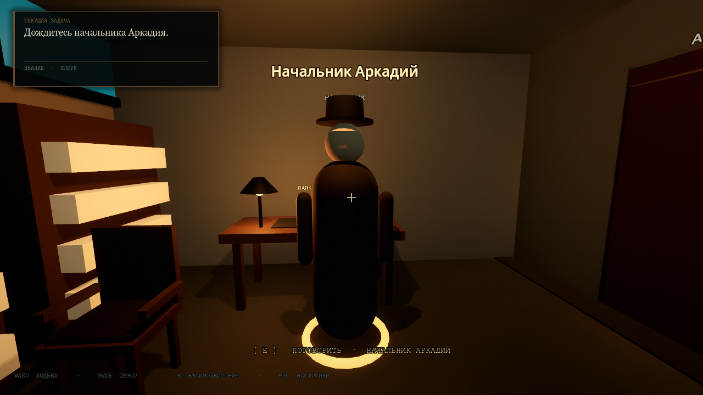
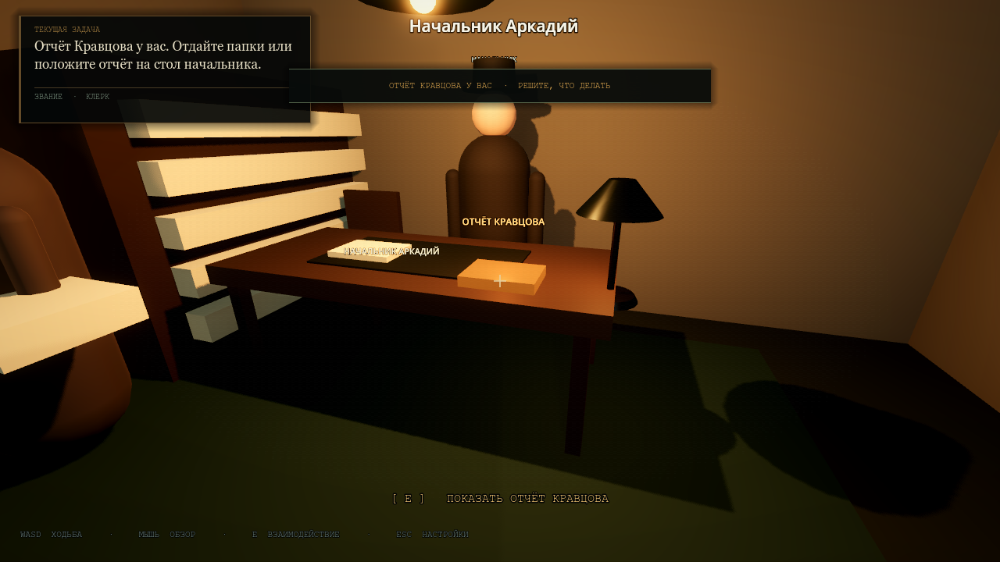
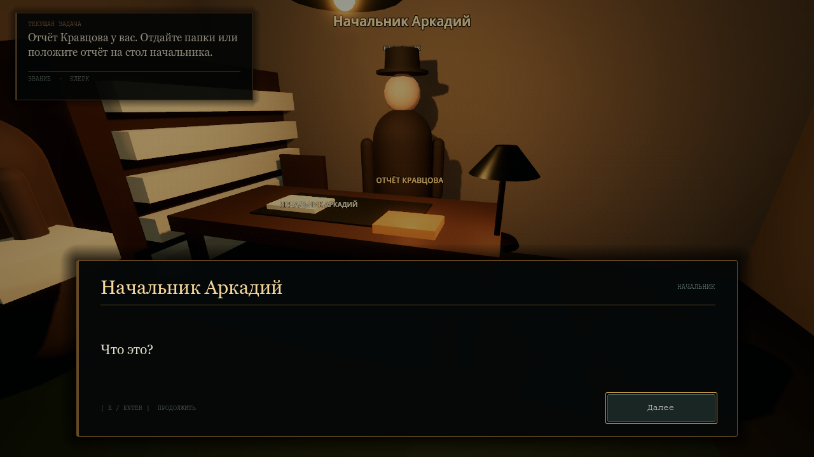

# Precinct 7 — First Day

A self-contained **Godot 4.3** first-person police-station career prototype. The player is a twenty-two-year-old clerk who starts in the archive, receives a folder-delivery order from Chief Arkady, crosses a living station, is warned by a detective about the Kravtsov case, and earns a promotion to **Duty Officer** at the Chief's second-floor desk.

Everything is made from Godot primitives (`BoxMesh`, `CylinderMesh`, `CapsuleMesh`, `SphereMesh`, `TorusMesh`), `StandardMaterial3D`, procedural lights, particles and no imported assets.



## Quick start

1. Open `project.godot` in Godot 4.3 (Forward+).
2. Press **F5**. The main scene is `res://scenes/Station.tscn`.
3. Walk to the archive desk and wait for Chief Arkady to approach.
4. Use **E** to interact, **WASD** to move, mouse to look, **Esc** for settings.
5. Follow the objective panel in the top-left.

The older archive chapter (`scenes/Archive.tscn`) and duty-room chapter (`scenes/DutyRoom.tscn`) remain in the project and can be launched with **F6** from the editor.

## Playthrough

1. Spawn in the archive. Chief Arkady walks up and opens the three-line intro dialogue.
2. Dismiss the conversation. The objective changes to **Pick up the folders from the archive desk**.
3. Aim at the glowing folder and press **E**. The objective points to the second-floor office.
4. Leave the archive. Detective Vlasov stops the player and reveals that the folder is a prop; the real Kravtsov report is in his locker in the break room.
5. **Optional investigation:** enter the break room and interact with `LockerClue`. The report appears on the Chief's desk and the objective changes to the final decision.
6. Climb the staircase to the mezzanine. The Chief waits behind his desk.
7. Choose a path:
   - **Hand over the folders** at the Chief's desk: promotion to **Duty Officer**; if the report was found it remains in the player's pocket.
   - **Show the Kravtsov report** (the orange report on the desk): confrontation dialogue, `confront_chief`, no promotion, truth kept.
8. The HUD objective and final toast reflect the chosen ending.





## Project files

| File | Purpose |
| --- | --- |
| `scenes/Station.tscn` | Main scene: architecture, props, NPCs, navmesh, player, HUD and dialogue layer. |
| `scenes/NPC.tscn` | CharacterBody3D NPC: capsule body, head, hat, name/role labels, nav agent, focus ring. |
| `scenes/Player.tscn` | First-person CharacterBody3D with camera and interaction RayCast3D. |
| `scenes/StationDialogueUI.tscn` | Bottom-screen dialogue layer. Named StationDialogueUI to avoid colliding with the older Chapter 1 `DialogueUI.tscn`. |
| `scenes/StationHUD.tscn` | Objective, rank, interaction prompt, crosshair and toasts. |
| `scenes/StationDoor.tscn` | Area3D-triggered swinging door with AnimationPlayer. |
| `scripts/station.gd` | Story controller and interaction router. |
| `scripts/station_npc.gd` | Idle/Walking/Talking state machine and NavigationAgent3D movement. |
| `scripts/dialogue_manager.gd` | `DialogueManager` autoload. |
| `scripts/quest_manager.gd` | `QuestManager` autoload. |
| `scripts/station_dialogue_ui.gd` | Renders DialogueManager lines and forwards Next/Enter/E. |
| `scripts/station_hud.gd` | Objective/rank/prompt UI. |
| `scripts/station_door.gd` | Runtime-built open/close AnimationPlayer clips. |
| `scripts/station_interactable.gd` | Generic folder/desk ray interactable and highlight. |
| `resources/dialogues/*.tres` | Data-driven dialogue chains. |
| `project.godot` | Main scene, autoloads and input map. |

## Scene trees

### `Station.tscn`

```text
Station (Node3D, station.gd)
├─ WorldEnvironment
├─ ColdDirectional
├─ Lighting
│  ├─ HallPendant / HallPendantNorth
│  ├─ ArchivePendant
│  ├─ BreakPendant
│  ├─ OfficePendant / CorridorPendant
│  ├─ StairPendant / StairSconce / StairFill
│  └─ ColdWindowSpill
├─ NavigationRegion3D
│  ├─ Architecture
│  │  ├─ GroundFloor, Ceiling, outer walls, wainscot
│  │  ├─ WindowNight/Frames, reception, bulletin board
│  │  ├─ ArchiveNorthWall/WallA/WallB/Lintel/Ceiling
│  │  ├─ ArchiveDesk/Chair/Shelves/Boxes/Lamp
│  │  ├─ Clerk desks, typewriters, paper, cabinets, bench
│  │  ├─ Break room walls, kitchenette, coffee machine, lockers
│  │  ├─ MezzanineFloor, OfficeWestWall, office railing
│  │  ├─ Ramp, RampStep0…9, Riser1…9, Nosing0…9
│  │  ├─ Ramp/StringerWest/East, RampRailWest/East
│  │  ├─ RampRail*/HandrailCap, BalusterWest/East2…8
│  │  ├─ NewelWest/EastBottom/Top
│  │  └─ Office desk legs, bookshelf, blotter, lamp, sign
│  ├─ Props
│  │  ├─ Folder (StaticBody3D, station_interactable.gd)
│  │  ├─ ChiefDesk (StaticBody3D, station_interactable.gd)
│  │  ├─ LockerClue (StaticBody3D, station_interactable.gd)
│  │  └─ EvidenceReport (StaticBody3D, hidden until found)
│  └─ Doors
│     ├─ ArchiveDoor (StationDoor.tscn)
│     ├─ BreakDoor (StationDoor.tscn)
│     ├─ ArchiveDoorLink (NavigationLink3D)
│     └─ BreakDoorLink (NavigationLink3D)
├─ Waypoints
│  ├─ HallP01…P04              (group: hall_route)
│  ├─ CorridorP01…P03          (group: corridor_route)
│  ├─ BreakP01…P03             (group: break_route)
│  └─ ChiefOffice              (manual destination)
├─ NPCs
│  ├─ Chief (NPC.tscn)
│  ├─ DetectiveVlasov
│  ├─ DetectiveMorozov
│  ├─ ClerkElena
│  ├─ OfficerVetrov
│  ├─ SecretaryAnna
│  └─ ClerkPavel
├─ Triggers
│  └─ DetectiveTrigger (Area3D)
├─ Player (Player.tscn)
├─ StationHUD (StationHUD.tscn)
├─ StationDialogueUI (StationDialogueUI.tscn)
├─ SettingsUI (SettingsUI.tscn)
└─ NoirOverlay (NoirOverlay.tscn)
```

### `NPC.tscn`

```text
NPC (CharacterBody3D, station_npc.gd, layer 3 / mask World|Doors)
├─ Visual
│  ├─ Body (CapsuleMesh, tinted by uniform_color)
│  ├─ Head (SphereMesh)
│  ├─ LeftArm / RightArm (CapsuleMesh)
│  └─ Hat (visible for Chief/Detective)
├─ NameLabel (Label3D, billboard)
├─ RoleLabel (Label3D, billboard)
├─ FocusRing (TorusMesh, shown by the interaction ray)
├─ CollisionShape3D (CapsuleShape3D)
└─ NavigationAgent3D
```

### `Player.tscn`

```text
Player (CharacterBody3D, scripts/player.gd, in group "player")
├─ CollisionShape3D (CapsuleShape3D)
└─ Head
   └─ Camera3D
      └─ InteractionRay (RayCast3D, target_position = (0, 0, -2.5), mask = 5)
```

The Station instance overrides the player's `collision_mask` to **13** so the player collides with World (1), Interactables/NPCs (4) and Doors (8). NPCs use layer **4** so the interaction ray (mask 5) can see them. Door bodies use layer **8** and are excluded from the nav bake.

## Core systems

### NPC state machine

`scripts/station_npc.gd` exports:

```gdscript
@export var npc_name: String = "Officer"
@export var role: String = "Clerk"
@export_enum("Clerk", "Detective", "Chief", "Officer", "Secretary")
var role_type: String = "Clerk"
@export var dialogue: DialogueLine
@export var uniform_color: Color
@export var walk_speed: float = 1.5
@export var idle_time_min: float = 2.5
@export var idle_time_max: float = 6.0
@export var waypoint_group: StringName
```

States:

- **Idle** — stands at the current marker; after a random delay it chooses the next waypoint.
- **Walking** — follows `NavigationAgent3D.get_next_path_position()`, turns smoothly, and bobs slightly.
- **Talking** — stops pathing, faces the player, and restores its patrol after the dialogue closes.

Waypoint markers can be any `Marker3D` in the scene. Put them in a group, set `waypoint_group` on the NPC, and the route is built automatically and sorted by node name (`P01`, `P02`, ...).

### Dialogue

`DialogueManager` is an autoload. It owns:

```gdscript
var current_line: DialogueLine
var is_active: bool
var current_actor: Node

func start_dialogue(first_line: DialogueLine, actor: Node = null) -> bool
func advance() -> void
func stop_dialogue() -> void
func reset() -> void
```

Signals:

```gdscript
signal dialogue_started(first_line: DialogueLine)
signal line_changed(line: DialogueLine)
signal dialogue_finished
signal event_triggered(event_name: String, payload: String)
```

Dialogue data lives in `DialogueLine` Resources:

```gdscript
@export var speaker: String
@export_multiline var text: String
@export var speaker_ru: String
@export_multiline var text_ru: String
@export var next_line: DialogueLine
@export var event_name: String
@export var event_payload: String
```

`StationDialogueUI` listens to the manager and renders the current line. It does **not** contain story logic. Player movement is locked in `DialogueManager` while a chain is active.

### Dialogue events

An event on a line fires when that line is dismissed. If it is the final line, the manager first closes the dialogue, unlocks the player, and then emits `event_triggered`, so a scene change cannot leave the player frozen.

Handled events in `Station.gd`:

```gdscript
func _on_dialogue_event(event_name: String, payload: String) -> void:
    match event_name:
        "start_quest":        _handle_start_quest(payload)
        "start_investigation": _start_investigation(payload)
        "give_promotion":      _grant_promotion()
        "confront_chief":      _confront_chief()
        "change_scene":        _change_scene(payload)
```

The built-in promotion is on the final line of `resources/dialogues/chief_promotion_3.tres`:

```text
event_name = "give_promotion"
event_payload = "duty_officer"
```

The detective tip uses `start_investigation` / `kravtsov_tip`; the confrontation chain ends with `confront_chief` / `truth`. Both are handled by the same event dispatcher, so adding another branch does not require new UI code.

### Scene transition example

Add this to any final dialogue line:

```text
event_name = "change_scene"
event_payload = "res://scenes/DutyRoom.tscn"
```

The Station already routes that payload through:

```gdscript
func _change_scene(scene_path: String) -> void:
    if scene_path.is_empty() or not ResourceLoader.exists(scene_path):
        return
    get_tree().change_scene_to_file(scene_path)
```

No extra UI code is required.

### Quest / objective system

`QuestManager` is an autoload. Core API:

```gdscript
QuestManager.reset()
QuestManager.start_quest("deliver_folder", "Pick up the folders from the archive desk.")
QuestManager.set_objective("Deliver the folders to Chief Arkady's office on the second floor.")
QuestManager.set_flag("folder_taken")
QuestManager.has_flag("folder_taken")
QuestManager.promote("Duty Officer")
QuestManager.finish_quest("Promotion complete. You are now a Duty Officer.")
```

Signals:

```gdscript
signal objective_changed(text: String)
signal rank_changed(rank: String)
signal quest_started(quest_id: String)
signal quest_completed(quest_id: String)
signal flag_changed(flag: String, value: bool)
```

`StationHUD.tscn` is the top-left `CanvasLayer` UI. It listens to both signals and updates the objective panel and rank line without any direct coupling to `Station.gd`.

### Doors

`scenes/StationDoor.tscn`:

```text
StationDoor (Node3D, station_door.gd)
├─ FrameLeft / FrameRight / FrameTop
├─ Pivot
│  └─ DoorBody (StaticBody3D, collision_layer = 8)
│     ├─ Mesh
│     ├─ Shape
│     └─ Handle
├─ Trigger (Area3D, collision_mask = 6)
│  └─ CollisionShape3D
├─ AnimationPlayer
└─ DoorLabel (Label3D)
```

The script builds `door/open` and `door/close` animations at runtime and adds them to an `AnimationLibrary`. An Area3D trigger detects the player and NPCs, counts occupants, opens the door, and schedules a close. Because the door body is on the Doors layer and the navmesh bakes only layer 1, the navigation path runs through the doorway independently of the physical door. The `NavigationLink3D` nodes explicitly bridge the doorway nav islands.

## NavigationRegion3D setup

The shipped Station already contains a baked `NavigationMesh`; this section is for rebuilding or editing the level.

1. Add a `NavigationRegion3D` named **NavigationRegion3D** under the Station root.
2. Put all walkable floors, walls, desks, railings, the ramp and other static collision under it. Use `StaticBody3D` + `CollisionShape3D`.
3. Create a `NavigationMesh` resource on the region and set:
   - `cell_size = 0.25`
   - `cell_height = 0.25`
   - `agent_radius = 0.35`
   - `agent_height = 1.8`
   - `agent_max_climb = 0.32`
   - `agent_max_slope = 45`
   - parsed geometry = **Static Colliders**
   - source geometry = **Root Node Children**
   - collision mask = **1 (World)**
4. The doors use collision layer **4 (Doors)** and are ignored by the collision mask. The archive and break-room doorway also have `NavigationLink3D` connections (`ArchiveDoorLink`, `BreakDoorLink`), which make the route robust across the bakes.
5. Select the `NavigationRegion3D`, open the toolbar's **Bake NavigationMesh** action, and save the scene. The region's mesh is serialized into `Station.tscn`.
6. Verify with a `NavigationAgent3D` or the Navigation debug overlay:
   - archive desk → main hall;
   - main hall → ramp;
   - ramp → second-floor office.

`Station.gd` also has a runtime fallback in `_ensure_navigation()`: if the saved navmesh is empty, it creates the `NavigationMesh`, temporarily disables door collision, bakes synchronously, and restores the doors. This means an edited scene still becomes playable at launch, although a baked mesh is recommended for release.

Do not place the player or NPC nodes under `NavigationRegion3D`; they are dynamic actors. Static colliders only belong under the region.

## Add another NPC

1. Instance `scenes/NPC.tscn` under `Station/NPCs`.
2. Set `npc_name`, `role`, `role_type`, `uniform_color`, `walk_speed`.
3. Assign a `DialogueLine` `.tres` to `dialogue`.
4. For a walking NPC, create Markers under `Station/Waypoints`, put them in a group such as `hall_route`, and set the NPC's `waypoint_group` to that group.
5. Leave `start_active = false`; `Station._activate_npcs()` activates every NPC after navigation is ready.
6. The NPC is automatically interactable with the player's E ray. No extra code is required for ordinary talk.

The NPC's dialogue is started by `Station.gd` when the player presses E while it is focused.

## Add a dialogue

Create a new `DialogueLine` `.tres` (or duplicate an existing one), fill in `speaker`, `text`, and link `next_line` for a chain. Assign the first line to an NPC, or pass it to `DialogueManager.start_dialogue()` from a story trigger.

For a new story event, add the handler in `Station.gd`:

```gdscript
"my_event":
    do_something(payload)
```

## Add a quest trigger

Use an `Area3D` or an `interactable` script. Existing examples:

- **DetectiveTrigger** — a one-shot `Area3D` that fires the detective's warning after the folder is taken.
- **LockerClue** — `StationInteractable` with `interaction_id = "locker_clue"`; locked until `tip_received`, gives `evidence_found`.
- **EvidenceReport** — `StationInteractable` with `interaction_id = "evidence_report"`; hidden until the locker is searched, then revealed on the Chief's desk.
- **Folder** — `StationInteractable` with `interaction_id = "folder"`.
- **ChiefDesk** — `StationInteractable` with `interaction_id = "chief_desk"`.

`Station.gd` centralizes the interaction rules and story flags, so new props don't need their own game logic. The two office interactions create the branch: the desk hands over the folder, the report starts the confrontation.

## Input map and controls

| Input | Action |
| --- | --- |
| `move_forward` / `move_back` | W / S |
| `move_left` / `move_right` | A / D |
| `interact` | E |
| `ui_cancel` | Esc |

Station-specific additions:

- E on an NPC opens its dialogue.
- E on the glowing folder picks it up.
- E on Vlasov's locker in the break room takes the Kravtsov report (after his tip).
- E on the report on the Chief's desk starts the confrontation.
- E on the Chief's desk hands over the folders and starts the promotion path.
- The player is frozen while a dialogue is open.
- Esc opens Settings while free and closes it while open.

## Verification performed

- **Expanded story QA:** intro, folder pickup, detective tip, locker reveal, evidence prompt, standard promotion, truth/confrontation ending, rank retention on the truth path and desk lock after confrontation all pass.
- **Model checks:** archive chair beside the desk; door with glass/lever/hinge/kick-plate children; staircase risers, nosings, stringers, handrail caps, balusters and newel posts present.
- **Physical traversal:** the earlier windowed QA confirmed the automatic archive door opens and the player can walk through it, the player can climb the ramp to the mezzanine, the real camera ray focuses the folder, and the E event consumes it.
- **Navigation:** path queries verify archive → hall, hall → ramp, ramp → office, and archive → office through the doorway links.
- **Engine:** the earlier Station and movement checks passed in **Godot 4.3.stable**; the expanded story and model pass was run in **Godot 4.7.2**.

The temporary builder/QA harnesses are removed from the shipped project. The Station scene, baked navmesh and all content remain.

## Notes and limitations

- NPCs use primitive capsule bodies and simple bob motion; no skeletal animation, imported models or audio files are used.
- The station dialogue, objectives, prompts, NPC names/roles and room labels are localized into Russian. Russian is the default; English remains selectable in Settings.
- Graphics default to native render scale, 4× MSAA and 2048 shadow atlas for a sharper image; lower these in Project Settings on weaker GPUs.
- The old Archive and Duty Room scenes remain available as standalone prototypes.
